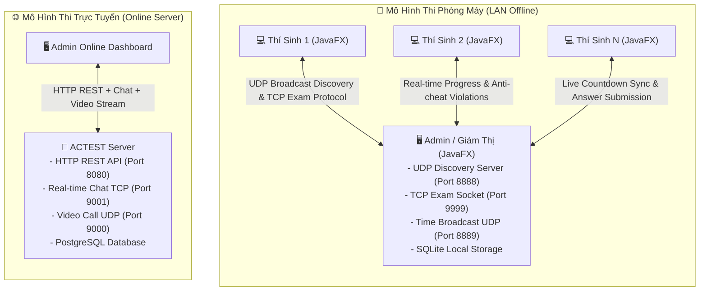

# 🎓 ACTEST - Hệ Thống Thi Trực Tuyến & Giám Sát Phòng Máy

<p align="center">
  
  
  
  
  
  
</p>

---

## 📌 Tổng Quan (Overview)

**ACTEST** là giải pháp phần mềm toàn diện hỗ trợ tổ chức thi trắc nghiệm, quản lý đề thi và giám sát chống gian lận trong môi trường thi tập trung (Phòng máy LAN Offline) lẫn trực tuyến (Online Central Server). Hệ thống được thiết kế theo kiến trúc module hóa hướng tới hiệu năng cao, độ trễ thấp và khả năng hoạt động mượt mà trên cả **Linux** và **Windows**.

---

## 🏗️ Kiến Trúc Hệ Thống (Architecture)



---

## ✨ Tính Năng Nổi Bật (Key Features)

### 1. 🖥️ Giám Thị / Quản Trị Viên (`admin`)
* **2 Chế Độ Linh Hoạt**:
  * **Offline LAN**: Hoạt động độc lập không cần Internet. Tự động phát hiện thí sinh trong mạng cục bộ thông qua UDP broadcast.
  * **Online Server**: Đồng bộ hóa dữ liệu với máy chủ trung tâm qua RESTful API, quản lý hồ sơ và ngân hàng câu hỏi.
* **Giám Sát Gian Lận Thời Gian Thực (Anti-Cheat Proctoring)**:
  * Tự động phát hiện khi thí sinh chuyển cửa sổ (Focus Lost), rời màn hình làm bài.
  * Tự động chụp ảnh màn hình vi phạm kèm timestamp và lưu trữ đối chiếu.
* **Quản Lý & Điều Khiển Kỳ Thi**:
  * Đếm ngược thời gian đồng bộ tới toàn bộ thí sinh.
  * Hỗ trợ Pause, Resume phiên làm bài theo từng IP của thí sinh (xử lý sự cố mất kết nối hoặc khởi động lại máy).
  * Tải và trích xuất kết quả thi ra file Excel (`.xlsx`) sử dụng Apache POI.
* **Giao Tiếp & Video Call**: Tích hợp module Chat TCP và Video Streaming UDP qua webcam (BridJ / Webcam-Capture).

### 2. 💻 Thí Sinh Làm Bài (`client`)
* **Tự Động Kết Nối (Zero-Config Discovery)**: Thí sinh chỉ cần nhập tên; ứng dụng tự động quét và hiển thị danh sách phòng thi / máy chủ giám thị trong mạng LAN.
* **Giao Diện Làm Bài Thông Minh (Azota-style Layout)**:
  * Khung xem câu hỏi trực quan, bảng điều hướng danh sách câu hỏi nhanh.
  * Hỗ trợ lưu đáp án tức thời sau mỗi thao tác chọn.
  * Đồng bộ đồng hồ đếm ngược với máy chủ giám thị qua UDP Broadcast.
* **Chống Gian Lận Nghiêm Ngặt**: Khóa toàn màn hình (Fullscreen Lock), cảnh báo và gửi tín hiệu vi phạm ngay khi mất focus.
* **Xem Lại Bài Thi**: Xem điểm tức thời và xem lại giải thích đáp án sau khi nộp bài (nếu được giám thị cho phép).

### 3. 🏢 Máy Chủ Trung Tâm (`server`)
* **RESTful Micro-service**: Xử lý đăng ký, gửi mã xác thực OTP qua Email, xác minh tài khoản, tìm kiếm bạn bè và quản trị ngân hàng đề thi.
* **Socket Servers**:
  * Chat TCP Server xử lý tin nhắn hai chiều bảo mật.
  * Video Call UDP Server truyền dẫn khung hình camera thời gian thực với độ trễ siêu thấp.
* **Cơ Sở Dữ Liệu PostgreSQL**: Quản lý người dùng, phân quyền Admin/Student, lưu trữ vĩnh viễn kết quả các đợt thi.

---

## 📁 Cấu Trúc Dự Án (Project Structure)

```
ACTEST/
├── .github/
│   └── workflows/
│       ├── ci.yml                 # CI/CD: Kiểm thử ma trận Ubuntu/Windows & Java 17/21
│       └── release.yml            # CI/CD: Đóng gói Release & đính kèm file chạy Linux/Windows
├── admin/                         # Module Giám thị (JavaFX Desktop App)
│   ├── src/main/java/             # Source code (Controllers, Models, Network, POI Export)
│   ├── src/main/resources/        # FXML views, CSS stylesheets, schema.sql
│   └── src/test/java/             # Unit tests cho Admin
├── client/                        # Module Thí sinh (JavaFX Desktop App)
│   ├── src/main/java/             # Source code (Fullscreen taking, Discovery, Anti-cheat)
│   ├── src/main/resources/        # FXML views, CSS stylesheets
│   └── src/test/java/             # Unit tests cho Client
├── server/                        # Module Máy chủ trung tâm (Backend Core)
│   ├── src/main/java/             # HTTP Handlers, TCP Chat, UDP Video, DB Repositories
│   ├── src/main/resources/        # schema.sql PostgreSQL
│   └── src/test/java/             # Unit tests cho Server
├── run-server.sh / .bat           # Script khởi chạy nhanh Server (Linux / Windows)
├── run-admin.sh / .bat            # Script khởi chạy nhanh Admin (Linux / Windows)
├── run-client.sh / .bat           # Script khởi chạy nhanh Client (Linux / Windows)
├── .env.example                   # File mẫu cấu hình cổng và biến môi trường
├── .gitignore                     # Cấu hình bỏ qua tệp nhị phân và dữ liệu cục bộ
└── pom.xml                        # Maven Parent POM quản lý đa module
```

---

## 🛠️ Công Nghệ & Thư Viện Sử Dụng (Tech Stack)

| Thành Phần | Công Nghệ / Thư Viện | Mục Đích |
| :--- | :--- | :--- |
| **Ngôn Ngữ & Nền Tảng** | Java 17 LTS / Java 21 LTS | Runtime hiệu năng cao, hỗ trợ đa nền tảng |
| **Giao Diện Đồ Họa** | JavaFX 21 + FXML + CSS | Giao diện desktop hiện đại, phản hồi nhanh |
| **Cross-Platform Native** | OpenJFX Multi-classifier | Tích hợp sẵn `.so` (Linux) và `.dll` (Windows) |
| **Cơ Sở Dữ Liệu** | SQLite 3.42 + PostgreSQL 42.6 | SQLite nội bộ cho phòng máy, Postgres cho trung tâm |
| **Xử Lý Dữ Liệu JSON** | Jackson Databind 2.15 | Serialization / Deserialization tốc độ cao |
| **Xuất Nhập Báo Cáo** | Apache POI 5.2 | Đọc và ghi đề thi, kết quả thi ra định dạng Excel |
| **Xử Lý Webcam / Video** | Webcam-Capture + BridJ | Bắt hình ảnh camera phục vụ giám sát và video call |
| **Gửi Mail & Xác Thực** | Jakarta Mail (Angus) | Gửi OTP và thông báo qua giao thức SMTP |
| **Kiểm Thử Tự Động** | JUnit 5 (Jupiter 5.10) | Bộ kiểm thử đơn vị tự động hóa |
| **Tự Động Hóa & CI/CD** | GitHub Actions | Matrix testing trên Ubuntu & Windows, tự động đóng gói Release |

---

## 🚀 Hướng Dẫn Cài Đặt & Chạy Ứng Dụng

### Yêu Cầu Môi Trường (Prerequisites)
* **Java JDK**: Phiên bản 17 hoặc 21 (Khuyên dùng [Eclipse Temurin](https://adoptium.net/)).
* **Apache Maven**: Phiên bản 3.8.0 trở lên (`mvn -version`).
* *(Tùy chọn cho Online Server)*: Cơ sở dữ liệu PostgreSQL đang chạy.

---

### 1. Biên Dịch & Đóng Gói (Build)

Clone dự án và build toàn bộ các module:
```bash
git clone https://github.com/<your-username>/ACTEST.git
cd ACTEST

# Biên dịch và đóng gói toàn bộ dự án
mvn clean package
```

Sau khi build thành công, 3 tệp JAR tự thực thi (Fat JARs) độc lập sẽ được tạo:
* `server/target/actest-server.jar` (~4 MB)
* `client/target/actest-client.jar` (~23 MB - đã tích hợp sẵn thư viện JavaFX cho cả Linux & Windows)
* `admin/target/actest-admin.jar` (~42 MB - đã tích hợp sẵn JavaFX, POI, Webcam Native Libs cho cả Linux & Windows)

---

### 2. Khởi Chạy Ứng Dụng (Run)

#### 🐧 Trên Linux / macOS:
Sử dụng các script có sẵn:
```bash
# Cấp quyền thực thi (nếu cần)
chmod +x run-server.sh run-admin.sh run-client.sh

# Chạy Server trung tâm
./run-server.sh

# Chạy bảng điều khiển Giám thị
./run-admin.sh

# Chạy ứng dụng Thí sinh
./run-client.sh
```

Hoặc chạy trực tiếp với lệnh `java`:
```bash
java -jar server/target/actest-server.jar
java -jar admin/target/actest-admin.jar
java -jar client/target/actest-client.jar
```

#### 🪟 Trên Windows:
Nhấp đúp chuột (Double click) vào các tệp `.bat` hoặc chạy qua Command Prompt / PowerShell:
```cmd
run-server.bat
run-admin.bat
run-client.bat
```

Hoặc chạy qua lệnh Java:
```cmd
java -jar server\target\actest-server.jar
java -jar admin\target\actest-admin.jar
java -jar client\target\actest-client.jar
```

---

### 3. Chạy Bằng Plugin Maven Trong Quá Trình Phát Triển (Dev Mode)

Nếu bạn đang phát triển và chỉnh sửa mã nguồn:
```bash
# Khởi chạy Admin JavaFX
mvn javafx:run -pl admin

# Khởi chạy Client JavaFX
mvn javafx:run -pl client

# Khởi chạy Server
mvn compile exec:java -pl server -Dexec.mainClass="com.actest.server.ServerApp"
```

---

## ⚙️ Cấu Hình Hệ Thống (.env)

Tạo tệp `.env` tại thư mục gốc từ mẫu `.env.example`:
```bash
cp .env.example .env
```

Nội dung tệp cấu hình:
```properties
# Địa chỉ IP và cổng dịch vụ
SERVER_HOST=127.0.0.1
SERVER_PORT=8080
CHAT_PORT=9001
VIDEO_PORT=9000

# Cấu hình CSDL SQLite cho Giám thị (Offline Mode)
DB_URL=jdbc:sqlite:actest_admin.db

# Cấu hình CSDL PostgreSQL cho Server (Online Mode)
# DB_URL=jdbc:postgresql://localhost:5432/actest
# DB_USER=chien
# DB_PASSWORD=totolink
```

---

## 🧪 Kiểm Thử Tự Động (Testing)

Dự án tích hợp đầy đủ bộ Unit Test JUnit 5 cho cả 3 module, đảm bảo tính toàn vẹn của mô hình dữ liệu, cơ chế mã hóa UTF-8, định dạng gói tin mạng và quy trình xử lý Base64:

```bash
# Chạy toàn bộ Unit Tests
mvn clean test
```

Báo cáo kết quả kiểm thử:
```
[INFO] -------------------------------------------------------
[INFO]  T E S T S
[INFO] -------------------------------------------------------
[INFO] Running com.actest.server.ServerModelTest
[INFO] Tests run: 5, Failures: 0, Errors: 0, Skipped: 0
[INFO] Running com.actest.client.ClientModelAndProtocolTest
[INFO] Tests run: 4, Failures: 0, Errors: 0, Skipped: 0
[INFO] Running com.actest.admin.AdminConfigAndProtocolTest
[INFO] Tests run: 4, Failures: 0, Errors: 0, Skipped: 0
[INFO] ------------------------------------------------------------------------
[INFO] BUILD SUCCESS
[INFO] ------------------------------------------------------------------------
```

---

## 🔄 Tự Động Hóa CI/CD (GitHub Actions)

Hệ thống CI/CD được thiết lập với 2 workflows:

1. **`ci.yml` - Ma Trận Kiểm Thử Tự Động**:
   * Kích hoạt khi có `push` hoặc `pull_request` vào nhánh `main`.
   * Chạy kiểm thử song song trên:
     * **Hệ điều hành**: `ubuntu-latest`, `windows-latest`
     * **Phiên bản Java**: Temurin JDK 17, Temurin JDK 21
   * Tự động lưu trữ báo cáo kiểm thử Surefire Reports.

2. **`release.yml` - Tự Động Đóng Gói & Xuất Bản Release**:
   * Kích hoạt khi gắn thẻ tag (ví dụ: `git tag v1.0.0 && git push origin v1.0.0`) hoặc kích hoạt thủ công qua giao diện `workflow_dispatch`.
   * Tự động build và nén các gói cài đặt hoàn chỉnh:
     * 📦 `actest-linux-x64.tar.gz` & `.zip`: Kèm toàn bộ JARs và scripts `.sh`.
     * 📦 `actest-windows-x64.zip`: Kèm toàn bộ JARs và scripts `.bat`.
     * ☕ `actest-server.jar`, `actest-client.jar`, `actest-admin.jar`: Các tệp Fat JAR đa nền tảng độc lập.
   * Tự động phát hành bản GitHub Release đính kèm release notes và tệp nhị phân tải về trực tiếp.

---

## 🛡️ Cơ Chế Giám Sát Chống Gian Lận (Proctoring Mechanism)

* **Phát Hiện Mất Tiêu Điểm (Focus Loss Detection)**:
  * Ứng dụng client liên tục theo dõi trạng thái `focusedProperty()` của cửa sổ.
  * Khi thí sinh chuyển cửa sổ (Alt + Tab, mở trình duyệt, mở ứng dụng khác), sự kiện vi phạm được kích hoạt ngay lập tức.
* **Chụp Ảnh Bằng Chứng (Screenshot Evidence)**:
  * Client tự động chụp màn hình hiện tại, mã hóa sang Base64 và truyền tải về máy giám thị qua socket TCP theo định dạng `VIOLATION:FOCUS_LOST:<examId>:<base64Data>`.
  * Phía Admin tự động lưu bằng chứng vào thư mục `violations/` và ghi nhận lịch sử vào cơ sở dữ liệu.
* **Khóa Chế Độ Toàn Màn Hình (Fullscreen Enforcement)**:
  * Khi bắt đầu làm bài, Client chuyển sang chế độ Fullscreen không thể thu nhỏ cho đến khi nộp bài.

---

## 🤝 Đóng Góp & Phát Triển (Contributing)

Mọi đóng góp nhằm nâng cao tính ổn định và tính năng của ACTEST đều được chào đón:
1. Fork dự án
2. Tạo nhánh tính năng (`git checkout -b feature/AmazingFeature`)
3. Commit thay đổi (`git commit -m 'feat: Add some AmazingFeature'`)
4. Push lên nhánh của bạn (`git push origin feature/AmazingFeature`)
5. Mở một Pull Request mới

---

## 📄 Bản Quyền (License)

Dự án được phân phối dưới giấy phép mã nguồn mở. Xem chi tiết tại tệp [LICENSE](LICENSE) (nếu có).

<p align="center">
  Phát triển với ❤️ bởi <b>Trịnh Quyết Chiến</b> và đội ngũ ACTEST.
</p>
